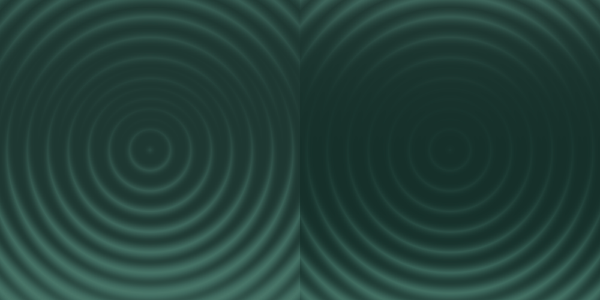
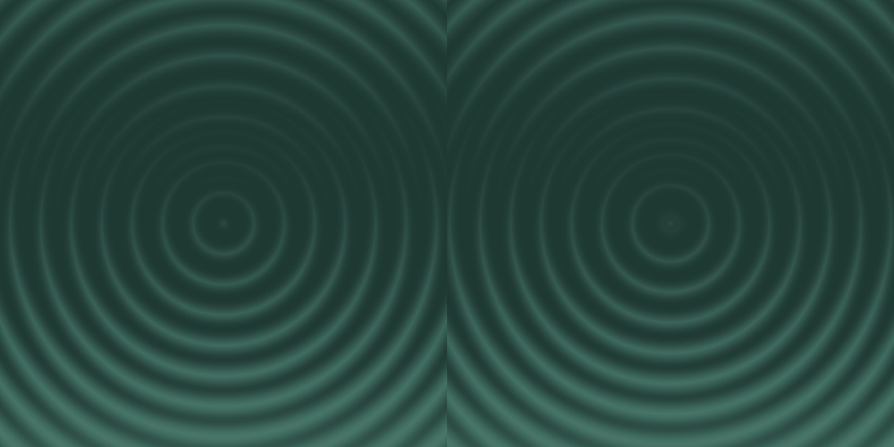

# Pattern motion studies

Open **`/patterns/motion`** for one isolated comparison page. It runs one selected study at a time, with all four pattern families, a dedicated Concentric ripple, their original density presets, Forest Light / Forest Dark / homepage Iris colors, pause, manual phase, intensity, duration, and a still-comparison toggle. Homepage backgrounds now use Light Tide or Expanding waves; see the homepage integration notes below.

| Study | Default loop | Movement |
| --- | --- | --- |
| Tonal breath | 10 seconds | Existing highlights open and recede in an unhurried breath. |
| Light tide | 12 seconds | A broad vertical light wave crosses the existing tones. |
| Orbiting sheen | 14 seconds | A broad light lobe circles the field; the pattern itself does not rotate. |
| Silk interference | 16 seconds | Two low-frequency, diagonal harmonics overlap. |
| Expanding waves (Concentric) | 8 seconds | Source rings move continuously outward by one pitch per cycle. |

These are new motion interpretations, not animations specified by the Figma file. Pattern geometry, source gradient tables and source color-role values are unchanged. “Palette-preserving” means the RGB/P3 color-role uniforms stay fixed; individual pixels change as the shader blends those same colors in different proportions. The four tonal studies animate no HSV rotation, new colors, geometry displacement, zoom or mask resampling. Expanding waves intentionally moves Concentric ring geometry by resampling the original cached masks radially; it keeps the palette fixed.

## Implementation

`MotionPattern` is a separate opt-in component using the existing WebGL2 renderer. It accepts the original `PatternOptions` plus `motion`, `duration`, `intensity`, `playing`, and optional deterministic `phase` (0–1). Supplying `phase` freezes automatic playback for inspection. Tonal wave terms are periodic sine/cosine harmonics; phase 0 and phase 1 reduce to the original composite. No easing reset or crossfade disguises the seam.

```tsx
import { MotionPattern } from '@/components/patterns/motion-pattern';

<div style={{ width: '100%', height: 480 }}>
  <MotionPattern
    kind="concentric"
    count={15}
    mode="dark"
    motion="tide"
    duration={12}
    intensity={0.7}
  />
</div>
```

- `motion-presets.ts`: four names, descriptions, shader IDs, and default durations.
- `motion-pattern.tsx`: one lifecycle for preparation, the clock, visibility, reduced motion, resizing and context restoration.
- `shaders.ts`: a periodic exposure-like remapping of existing highlight masks before the original color compositing. The gain is `exp2(3.2 * intensity * signal)`; source mask endpoints stay fixed, and the original still is exact at zero phase. Geometry and sampling coordinates remain fixed.
- `renderer.ts`: `prepare()` retains only the final two masks; `drawMotion()` updates motion uniforms and issues one full-screen-triangle draw. The original `render()` path releases all temporary textures and remains static.
- `motion-lab.tsx` / `.module.css`: isolated page controls and presentation. It reuses the site's fonts, semantic colors, and original homepage Iris roles.

## Performance and device behavior

The expensive original gradient, ring/slit and blur passes run only when geometry, colors or dimensions change. Playback does not allocate GPU resources, upload textures, query GL state, regenerate geometry, or update palette uniforms. Uniform locations are cached. The animation loop targets at most 30 composite submissions per second; a slower device can deliver fewer frames while the phase still follows elapsed visible time.

The animated output is capped at DPR 1.5 and a 1024px longest edge. This bounds the retained pair of RGBA16F masks at approximately 17.7 MiB, plus the canvas. Initial preparation can use about three times the mask storage for blur scratch targets; those are deleted immediately after preparation. The lower-precision RGBA8 path uses half the mask memory. The existing still renderer retains its original DPR 2 / 2048px field limits.

Offscreen and hidden-document states stop the animation clock entirely. Returning resumes from the held phase. Reduced motion freezes automatic playback, including preference changes at runtime; manual scrubbing remains available. GPU context restoration rebuilds the paused/current scene. If WebGL2 is unavailable, the page shows an explanation and disables playback rather than showing an unrelated image. There is no WebGL1 or raster-animation fallback.

These choices follow [MDN's WebGL guidance](https://developer.mozilla.org/en-US/docs/Web/API/WebGL_API/WebGL_best_practices): avoid repeated allocations and blocking queries, bound the back buffer, release unused resources, and handle optional extensions. A small native WebGL pass is sufficient here; an additional scene library or animation framework would not reduce the work.

## Verification

Run against the production server:

```sh
npm run typecheck
npm run lint
npm run build
npm run start -- --port 3001
# In another terminal:
VISUAL_URL=http://127.0.0.1:3001 npm run test:pattern-motion
VISUAL_URL=http://127.0.0.1:3001 npm run visual:patterns
```

[Motion results](results.json) cover all 16 family/study combinations in Chromium and WebKit, raw-canvas phase 0/1 equality, quarter-cycle contrast thresholds (mean RGB change ≥ 3/255 and ≥ 20% of pixels changing by ≥ 8/255 in at least one channel), exact restoration of the original still, fixed palette uniforms, GPU allocation/query counts during playback, pause, dynamic reduced motion, context restoration and narrow-width/offscreen behavior. Raw-canvas comparisons exclude page captions and controls. The report includes actual composite submission rates; these are not GPU completion timings or a guarantee of display frame rate.

[Device results](devices.json) cover DPR 3 touch emulation, capped render dimensions, the RGBA8 fallback with the float-render-target extension disabled, unavailable WebGL2, and simulated document visibility events in both engines. These are automated browser tests on this host, not physical iOS/Android hardware benchmarks. Modern WebGL2 support is required; hardware-wide performance cannot be guaranteed from this run.

On 2026-10-26, all 32 family/study checks and six device/fallback cases passed with no page errors. The sampled composite submission rates were approximately 30/s in both engines, with zero GPU allocations, palette updates or blocking GL queries during playback. DPR 3 mobile emulation used a 525 × 525 drawing buffer for a 350px preview, retaining about 4.65 MiB of float masks (2.32 MiB for RGBA8). These measurements describe this test run rather than a universal frame-rate guarantee.

The original [28 Figma still comparisons](../results.json) also pass their existing tolerances. This guards the unchanged homepage and still studio. Type checking, lint and production build are checked separately.

- [Desktop page](chromium-desktop.png)
- [Narrow page](webkit-mobile.png)
- [Tide: original still](chromium-tide-still.png) / [quarter cycle](chromium-tide-quarter.png)
- [Orbit: original still](chromium-orbit-still.png) / [quarter cycle](chromium-orbit-quarter.png)

## Visibility correction

The initial additive blend used opposing layer adjustments that largely cancelled, and the 16–28 second loops were too faint. The revised default is 70% intensity with 10–16 second loops. Existing palette colors and pattern geometry remain unchanged. Contrast thresholds now guard against that regression; they supplement visual inspection rather than prove perceived motion. The default Tide comparison below shows phase 0 (left) and phase 0.25, three seconds later (right).



## Concentric outward waves

Selecting Concentric now defaults to **Expanding waves** (8 seconds); selecting another family defaults to **Light Tide** (12 seconds). The other tonal studies remain available for comparison. These same approved defaults are now used on the homepage.

The new composite advects the existing mask radially by the captured ring pitch (42 source units for 15 rings, 21 for 29). Two source samples one pitch apart have aligned ring crests. A smoothstep blend moves between their slightly different source envelopes, closing the cycle without reversing direction or zooming the whole field. The small center emergence region fades in each new ring. Outside the cached field, samples continue from the neighboring inner ring. These are motion design decisions, not animated behavior specified by Figma.

At the default 70% intensity, the ripple is fully moving; lower values blend with the still, and zero restores it. The GPU still draws one composite per frame from the retained source masks, with no per-frame texture creation. Existing frame cap, visibility pause, reduced-motion and context-restoration behavior apply.

The motion test additionally verifies both original ring counts in all three palettes in Chromium and WebKit: exact endpoint equality, low image change across the wrap, and radial tracking that matches outward displacement better than inward displacement. Playback performance checks now run on the ripple. The device checks also start with the ripple selected.



## Homepage integration

All ten homepage pattern placements (eleven canvases including Safari’s glass backdrop) now use the approved motion: Light Tide at 12 seconds for Drift, Offset and Single band; Expanding waves at 8 seconds for Concentric. Intensity is 70%. Existing source colors, crop bounds, rotation, ring/slit counts and section layouts remain unchanged.

`HomePattern` preserves the measured viewport and artwork crop. `HomeMotionPattern` selects the family’s motion and consumes `MotionPlaybackContext`. The application cards provide playback state: pointer hover or keyboard focus starts motion; the GSAP reveal reverses on exit, then pauses the shader once fully faded out. Ordinary backgrounds play only while intersecting the viewport. Reduced motion disables automatic playback throughout. The still studio and `/patterns/render` comparison fixtures continue using the static renderer.

Reproduce homepage playback checks with `VISUAL_URL=http://127.0.0.1:3001 npm run test:home-motion`. They check every nonzero-size placement at desktop and narrow widths in Chromium and WebKit, motion selection, advancing frames, hidden-hover and offscreen pauses, reduced motion and overflow. Reports and screenshots are in `docs/patterns/homepage-motion/`. The application hover suite separately exercises GSAP reveal/reversal, keyboard focus, responsive layouts and touch links.
