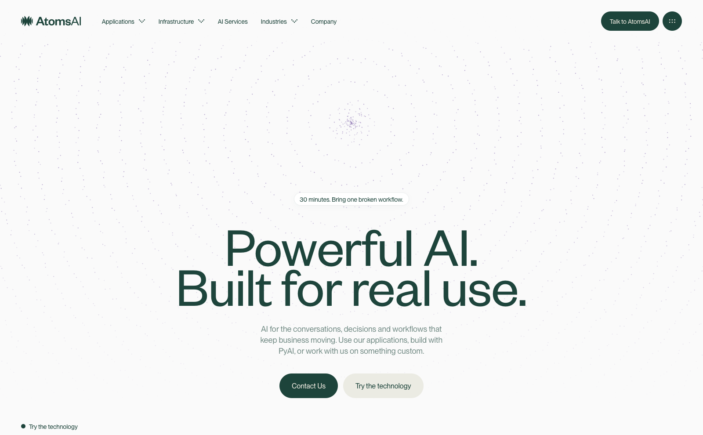

# Reload / full-screen iris regression

## Diagnosis

Blocking the homepage CSS reproduces a full-screen purple field. The shader's
absolute dimensions were inline, but its containing/clipping boundary depended
on a CSS module. Without that stylesheet, the final iris shader sized against
the page and painted over the content. `before-css-unavailable.png` records the
reproduction in WebKit before the fix.

The local preview had also been a production server reading `.next/` while
subsequent production checks rebuilt that same directory. Next owns and replaces
that directory during builds, so requests can encounter missing/mismatched
chunks. This is a plausible trigger for the reported intermittent CSS failure;
the original reload's network trace is not available.

## Fix

- `HomePattern` now includes size/layout/paint containment and overflow clipping
  in server-rendered inline styles. If CSS fails, the artwork stays inside a
  zero-height slot instead of escaping across the page. Normal styled geometry
  and animation are unchanged.
- The hero particle canvas stays hidden until its positioning stylesheet exists,
  avoiding a canvas/host resize feedback loop when that stylesheet is missing.
- The editing preview uses `next dev` with `.next-preview/`, separate from the
  `.next/` production output. Port 3001 now runs that preview.
- Production servers must be stopped before rebuilding their own `.next/`.
  Development preview and production validation can run concurrently.

## Reproduce checks

```sh
npm run build
npm start -- --port 3010
# In another terminal:
VISUAL_URL=http://127.0.0.1:3010 node scripts/reload-check.mjs
VISUAL_URL=http://127.0.0.1:3010 node scripts/home-pattern-check.mjs
```

`reload-check.mjs` blocks each CSS chunk separately, then all CSS, in Chromium
and WebKit. It verifies the independent containment boundary, then restores CSS
and reloads at 390, 815, and 1600px, at the top and technology section. Screenshots
and `results.json` record the output. The shader integration check separately
checks all twelve shader canvases, excluding the newer p5 particle canvas.

Validation: 10/10 shader integration cases passed (both engines, five widths),
plus typecheck, lint, and production build. `preview-build-check.json` records
five successful live-preview reloads across a concurrent production build,
without failed asset responses.

With every stylesheet deliberately blocked, the page is necessarily unstyled;
the regression requirement is that decorative shaders cannot cover its content.
This is not a promise to reproduce the designed layout without CSS.



